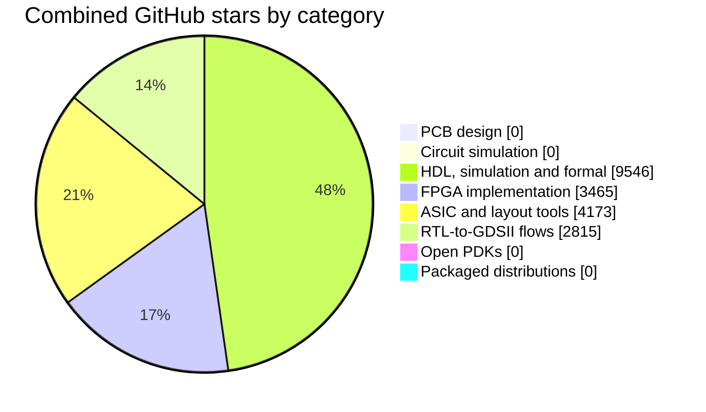

# Awesome Craft Hardware 

> A curated list of open-source tools for PCB, FPGA, ASIC and chip design.

This list separates individual EDA tools from RTL-to-GDSII flows and from process design kits (PDKs). Official vendor FPGA and ASIC toolchains are proprietary and are not listed. Community bitstream projects are unofficial and incomplete on some families, and they do not grant a licence to vendor IP. Open PDKs still have foundry or shuttle-program terms. Check each project licence, including bundled components such as OpenSTA inside OpenROAD.

Related lists: [Awesome Craft](https://github.com/EdisonTKPcom/Awesome-Craft).

## Contents

- [Dashboard](#dashboard)
- [PCB design](#pcb-design)
- [Circuit simulation](#circuit-simulation)
- [HDL, simulation and formal](#hdl-simulation-and-formal)
- [FPGA implementation](#fpga-implementation)
- [ASIC and layout tools](#asic-and-layout-tools)
- [RTL-to-GDSII flows](#rtl-to-gdsii-flows)
- [Open PDKs](#open-pdks)
- [Packaged distributions](#packaged-distributions)

## Dashboard

<table>
<tr>
<td align="center"><h2>35</h2>listed projects</td>
<td align="center"><h2>8</h2>categories</td>
<td align="center"><h2>20.0k</h2>combined GitHub stars</td>
<td align="center"><h2>5.3k</h2>combined forks</td>
<td align="center"><h2>10/11</h2>pushed in the last 30 days</td>
<td align="center"><h2>5</h2>languages</td>
</tr>
</table>

Stats snapshot taken on 2026-11-15 from the GitHub API, for GitHub-hosted repositories only. Official documentation and other non-GitHub entries are listed but have no stars, forks or push dates. Star badges next to GitHub entries update live.

### 🏆 Leaderboard

<table>
<tr><th>Rank</th><th>Project</th><th>Kind</th><th align="right">Stars</th><th></th></tr>
<tr><td align="center">🥇</td><td><b>Yosys</b></td><td>RTL synthesis</td><td align="right">4.9k</td><td><code>████████████████████</code></td></tr>
<tr><td align="center">🥈</td><td><b>Verilator</b></td><td>HDL simulator</td><td align="right">4.1k</td><td><code>█████████████████</code></td></tr>
<tr><td align="center">🥉</td><td><b>OpenROAD</b></td><td>Place and route</td><td align="right">3.3k</td><td><code>█████████████</code></td></tr>
<tr><td align="center">4</td><td><b>OpenLane</b></td><td>ASIC flow</td><td align="right">2.0k</td><td><code>████████</code></td></tr>
<tr><td align="center">5</td><td><b>nextpnr</b></td><td>Place and route</td><td align="right">1.8k</td><td><code>███████</code></td></tr>
<tr><td align="center">6</td><td><b>Project IceStorm</b></td><td>Bitstream docs</td><td align="right">1.2k</td><td><code>█████</code></td></tr>
<tr><td align="center">7</td><td><b>OpenROAD Flow Scripts</b></td><td>ASIC flow</td><td align="right">808</td><td><code>███</code></td></tr>
<tr><td align="center">8</td><td><b>Magic</b></td><td>Layout editor</td><td align="right">729</td><td><code>███</code></td></tr>
<tr><td align="center">9</td><td><b>SymbiYosys</b></td><td>Formal verification</td><td align="right">570</td><td><code>██</code></td></tr>
<tr><td align="center">10</td><td><b>Project Trellis</b></td><td>Bitstream docs</td><td align="right">477</td><td><code>██</code></td></tr>
</table>

### Stars by category

### Licences

   

"Custom" or "None" means GitHub could not match a standard SPDX licence, often because of extra terms or an undeclared licence. Read the project licence before you use it commercially.

## PCB design

- [Horizon EDA](https://github.com/horizon-eda/horizon) - A schematic and PCB tool with a pool-based library workflow. 
- [KiCad](https://www.kicad.org/) - A cross-platform EDA suite for schematic capture and PCB layout. The program is GPL-3.0-or-later; official libraries use CC-BY-SA 4.0.
- [LibrePCB](https://github.com/LibrePCB/LibrePCB) - A schematic and PCB editor with a consistent project library format. 

## Circuit simulation

- [ngspice](https://ngspice.sourceforge.io/) - A SPICE-class circuit simulator used standalone and behind other schematic tools. Licence commonly given as BSD-3-Clause; confirm in the source distribution.
- [Xschem](https://github.com/StefanSchippers/xschem) - A schematic editor often used in open analog flows with ngspice and Magic or KLayout. 
- [Xyce](https://github.com/Xyce/Xyce) - A parallel analog circuit simulator from Sandia National Laboratories, aimed at larger netlists. 

## HDL, simulation and formal

- [cocotb](https://github.com/cocotb/cocotb) - A Python framework for writing HDL testbenches that talk to simulators through VPI, VHPI and similar interfaces. 
- [GHDL](https://github.com/ghdl/ghdl) - A VHDL analyzer, compiler and simulator, with experimental synthesis paths. 
- [GTKWave](https://github.com/gtkwave/gtkwave) - A waveform viewer for VCD, FST and related simulation dumps. 
- [Icarus Verilog](https://github.com/steveicarus/iverilog) - A Verilog compiler and simulator. 
- [Surfer](https://github.com/surfer-project/surfer) - A waveform viewer with a modern interface. 
- [SymbiYosys](https://github.com/YosysHQ/sby) - A front-end for Yosys-based formal verification such as bounded model checking. Solver backends have their own licences. 
- [Verilator](https://github.com/verilator/verilator) - Compiles synthesizable Verilog and SystemVerilog into cycle-accurate C++ or SystemC models. Licence is LGPL-3.0-only or Artistic-2.0. 
- [Yosys](https://github.com/YosysHQ/yosys) - An RTL synthesis framework with Verilog and synthesizable SystemVerilog support, used in FPGA and ASIC flows. 

## FPGA implementation

- [Amaranth](https://github.com/amaranth-lang/amaranth) - A Python-based HDL and toolchain that can target open FPGA flows. 
- [LiteX](https://github.com/enjoy-digital/litex) - A framework for building SoCs from LiteX cores and putting them on FPGA boards. Individual cores and board files may carry their own terms. 
- [nextpnr](https://github.com/YosysHQ/nextpnr) - A timing-driven, portable FPGA place-and-route tool that uses architecture databases from the bitstream projects below. This is not a drop-in replacement for vendor P&R on every family. 
- [openFPGALoader](https://github.com/trabucayre/openFPGALoader) - A utility for programming many FPGA boards over common debug adapters. 
- [Project IceStorm](https://github.com/YosysHQ/icestorm) - Tools and documentation for Lattice iCE40 bitstreams, typically used with Yosys and nextpnr. This is community architecture documentation, not a vendor IDE. 
- [Project Oxide](https://github.com/gatecat/prjoxide) - Documentation and tooling for Lattice Nexus devices, intended for use with nextpnr. Coverage and device testing are still incomplete. 
- [Project Trellis](https://github.com/YosysHQ/prjtrellis) - Documentation and databases for Lattice ECP5 bitstreams, used with nextpnr. 
- [Project X-Ray](https://github.com/f4pga/prjxray) - Documentation and tooling for the Xilinx 7-series bitstream format. Coverage is incomplete relative to Vivado, and this is not official AMD or Xilinx support. 

## ASIC and layout tools

- [KLayout](https://github.com/KLayout/klayout) - A high-capacity layout viewer and editor with DRC and LVS scripting, often used for GDS and OASIS inspection. 
- [Magic](https://github.com/RTimothyEdwards/magic) - A layout editor and DRC tool long used in academic and open ASIC flows. 
- [Netgen](https://github.com/RTimothyEdwards/netgen) - A layout-versus-schematic comparison tool, typically paired with Magic. 
- [OpenROAD](https://github.com/The-OpenROAD-Project/OpenROAD) - A physical-design application covering floorplanning, placement, clock-tree synthesis and routing. The project is BSD-3-Clause but bundles OpenSTA, which is GPL-3.0. 
- [OpenSTA](https://github.com/parallaxsw/OpenSTA) - A static timing analysis engine that reads Liberty, Verilog, SDC, SPEF and SDF. Licence is GPL-3.0. 

## RTL-to-GDSII flows

- [LibreLane](https://github.com/librelane/librelane) - The maintained successor to Efabless OpenLane 2, an automated RTL-to-GDSII flow around Yosys, OpenROAD, Magic, Netgen and KLayout. This is a flow, not a PDK. 
- [OpenLane](https://github.com/The-OpenROAD-Project/OpenLane) - The earlier Efabless RTL-to-GDSII flow. Treat this as a legacy line unless a project you inherit still depends on it. 
- [OpenROAD Flow Scripts](https://github.com/The-OpenROAD-Project/OpenROAD-flow-scripts) - A reference RTL-to-GDSII flow that integrates Yosys, OpenROAD and KLayout. 
- [SiliconCompiler](https://github.com/siliconcompiler/siliconcompiler) - A modular hardware build system that can drive open-source and, where the user has licences, proprietary EDA tools. 

## Open PDKs

- [GlobalFoundries GF180MCU PDK](https://github.com/google/gf180mcu-pdk) - An open PDK for GlobalFoundries 180 nm MCU process. The repository licence is not a substitute for foundry or shuttle-program rules. 
- [IHP Open PDK](https://github.com/IHP-GmbH/IHP-Open-PDK) - Open PDK material from IHP, including the SG13G2 process used in several open analog and RF flows. Read IHP documentation and foundry access terms before use. 
- [SkyWater SKY130 PDK](https://github.com/google/skywater-pdk) - An open PDK for SkyWater 130 nm, widely used with LibreLane and OpenROAD flows. Tape-out still depends on foundry or shuttle-program terms. 

## Packaged distributions

- [OSS CAD Suite](https://github.com/YosysHQ/oss-cad-suite-build) - A binary distribution of YosysHQ and related digital-design tools. Bundled tools keep their individual licences. 

## Contributing

Contributions welcome! Read the [contribution guidelines](contributing.md) first.

If this list is useful, give it a ⭐ so others can find it.

